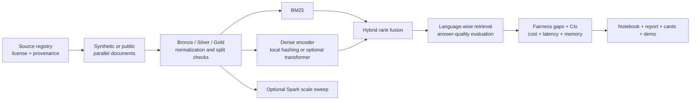

# Multilingual Retrieval Fairness

Capstone project by **Sujan S M (PES1UG24AM292)** and **Swasthik Pamadi (PES1UG24AM298)**.

The project studies whether a public-services retrieval assistant works equally well in **English, Malayalam and Hindi**. It compares lexical, dense and hybrid retrieval, measures language-wise gaps in recall and answer quality, evaluates translation and alignment mitigations, and records cost and systems evidence.

> This repository contains an executable smoke-test pipeline over a small synthetic parallel document set. It does not claim final research results. External datasets and transformer models are opt-in and require the licence, coverage and access checks documented in `data/source_registry.csv`.

## Research framing

- **RQ1:** How large is the retrieval gap across the three languages for the same information need?
- **RQ2:** Which retrieval configuration gives the best quality-cost trade-off?
- **RQ3:** Which mitigation closes the gap without unacceptable latency, memory or translation cost?

Required evidence is produced for both course components:

1. **Big-data systems:** scale sweep, partition count, storage bytes, throughput, optional Spark probe, and reproducibility manifest.
2. **Responsible AI:** per-language metrics, max-minus-min fairness gaps, confidence intervals, provenance/licence fields, no-personal-data assertion, and known limitations.

## Architecture



## Repository map

| Requirement | Location |
|---|---|
| README, architecture and setup | `README.md`, `docs/architecture.md` |
| Reproducible pipeline | `scripts/run_pipeline.py`, `src/mrfairness/`, `configs/` |
| Docker Compose | `Dockerfile`, `docker-compose.yml` |
| Results notebook | `notebooks/01_results.ipynb` |
| 3-5 page technical report | `report/technical_report.md` and `report/technical_report.pdf` |
| Data card | `cards/data_card.md` |
| Model card | `cards/model_card.md` |
| 3-minute demo | `demo/demo_video.avi`, `demo/demo_script.md` and `demo/README.md` |
| Dataset and licence register | `data/source_registry.csv` |
| Phase-I planning artifacts | `docs/phase1/` |

## Quick start

The smoke test uses only the Python standard library and runs offline.

```bash
python scripts/run_pipeline.py --config configs/smoke.json
```

Outputs:

```text
results/smoke/metrics.csv
results/smoke/fairness_summary.json
results/smoke/system_metrics.json
results/smoke/run_manifest.json
```

For the optional notebook and plots:

```bash
python -m pip install -r requirements.txt
jupyter notebook notebooks/01_results.ipynb
```

For a containerized smoke test:

```bash
docker compose up --build
```

For optional Spark evidence:

```bash
python -m pip install -r requirements-full.txt
python scripts/run_spark_scale.py --partitions 4
```

For optional transformer baselines, install `requirements-full.txt`. The pipeline records the requested model, the actual model used, and any fallback error in `run_manifest.json`. A smoke run never downloads a model or silently presents the hashing fallback as a transformer result.

## Experiment matrix

| ID | Method | Mitigation | Smoke behavior |
|---|---|---|---|
| `bm25` | BM25 | None | Fully offline lexical baseline |
| `labse` | Dense | None | Optional LaBSE; deterministic fallback offline |
| `multilingual_e5_base` | Dense | None | Optional multilingual-e5-base; deterministic fallback offline |
| `hybrid` | BM25 + dense RRF | None | Offline rank fusion |
| `translation` | Dense | English pivot query | Translation mitigation pilot using aligned query fields |
| `alignment_pilot` | Dense | Alignment feature | Explicit topic-alignment pilot, not a claim of full fine-tuning |

The full study should add real public/openly licensed sources only after their release, license and language coverage are recorded in `data/source_registry.csv`. The suggested Project 39 resources are FLORES-200, MIRACL, AI4Bharat IndicCorp, IndicQA, Samanantar, and Malayalam/Hindi Wikipedia. MIRACL's released language list must not be assumed to cover Malayalam.

## Responsible-AI guardrails

- No real personal data is used.
- Synthetic smoke data is clearly labeled and is not a substitute for final benchmark evidence.
- Scores are reported by language with confidence intervals and failure examples.
- Translation cost and model fallback status are logged.
- A retrieval gap is evidence about this benchmark and setup, not a universal fairness claim.
- Licenses, attribution and source-text rights must be rechecked before downloading external data.

## Team roles

- **Sujan:** data manifest, Spark/storage evidence, pipeline reproducibility and systems metrics.
- **Swasthik:** retrieval models, fairness analysis, governance, model/data cards.
- **Both:** experiment review, report, notebook, demo and final acceptance checklist.

## References

1. J. Zhang et al., “MIRACL: A Multilingual Retrieval Dataset Covering 18 Diverse Languages,” *TACL*, 2023. https://doi.org/10.1162/tacl_a_00595
2. R. Ramesh et al., “Samanantar: The Largest Publicly Available Parallel Corpora Collection for 11 Indic Languages,” arXiv:2104.05596. https://indicnlp.ai4bharat.org/samanantar/
3. D. Kakwani et al., “IndicNLPSuite,” ACL, 2020. https://aclanthology.org/2020.acl-demos.38/
4. NLLB Team, “No Language Left Behind,” arXiv:2207.04672. https://arxiv.org/abs/2207.04672
5. Facebook AI Research, FLORES repository. https://github.com/facebookresearch/flores
6. Apache Spark documentation. https://spark.apache.org/docs/latest/

